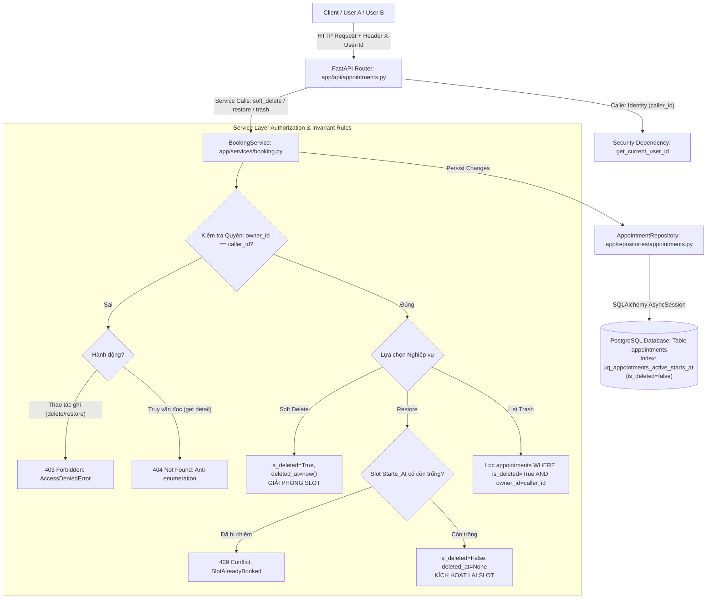

# KẾ HOẠCH TRIỂN KHAI DO AI LẬP & RÀNG BUỘC KIỂM TRA GIẢ ĐỊNH (AI IMPLEMENTATION PLAN & ASSUMPTION REVIEW)
**Bài tập cá nhân 3 — VT-116 | Production Readiness Lab (APP-03)**
- **Sinh viên thực hiện**: Nguyễn Việt Anh (MSSV: 23001827)
- **Nhóm**: SE2026-T29
- **Baseline Commit SHA**: `8fe9de89b719bde237a118e18a671db1d3dfd6cd`
- **Branch**: `bt3/23001827-vt116-soft-delete-restore`

---

## 1. PHÂN TÍCH VÀ PHÂN RÃ BÀI TOÁN (PROBLEM DECOMPOSITION)

Bài toán yêu cầu bổ sung tính năng **Xóa mềm (Soft Delete) và Khôi phục (Restore)** vào hệ thống đặt lịch hẹn, đồng thời xử lý triệt để **Risk trọng tâm: Phân quyền sai dẫn đến người dùng có thể đọc, xóa, khôi phục hoặc truy cập dữ liệu thuộc người dùng khác (Cross-user data leakage / Unauthorized mutation)**.

Căn cứ chỉ đạo trực tiếp của sinh viên Nguyễn Việt Anh tại **Human Checkpoint 1**, kế hoạch triển khai được phân rã thành 5 khối công việc:
1. **Mô hình dữ liệu & Schema Migration**:
   - Bổ sung trường `is_deleted` (Boolean, default=False) và `deleted_at` (DateTime with timezone, nullable=True).
   - Bổ sung trường `owner_id` (String(100), default="anonymous" hoặc ánh xạ customer_name) để xác định quyền sở hữu tài nguyên cho từng user.
   - **Hiệu chỉnh Partial Unique Index**: Thay đổi điều kiện partial index thành `WHERE status = 'booked' AND is_deleted = false`. Khi một booking bị soft delete, slot thời gian lập tức được giải phóng để người khác có thể đặt.
2. **Lớp Trừu tượng Dữ liệu (Repository Layer)**:
   - Cập nhật `AppointmentRepository`: hàm `list()` và `get()` mặc định lọc bỏ các bản ghi đã xóa mềm (`where(is_deleted == False)`), đồng thời hỗ trợ lọc theo `owner_id`.
   - Bổ sung hàm chuyên biệt: `soft_delete(id, owner_id)`, `restore(id, owner_id)`, `get_with_deleted(id, owner_id)`, `list_trash(owner_id, limit, offset)`.
3. **Lớp Nghiệp vụ (Service Layer)**:
   - Bổ sung `soft_delete()` trong `BookingService`: kiểm tra quyền sở hữu (`owner_id`), nếu không khớp trả về lỗi phân quyền, nếu khớp cập nhật `is_deleted = True, deleted_at = now()`. Idempotent nếu đã xóa mềm.
   - Bổ sung `restore()` trong `BookingService`: kiểm tra quyền sở hữu, kiểm tra invariant xung đột slot (nếu booking đang `booked`, kiểm tra xem slot `starts_at` có bị ai đặt trong thời gian bị ẩn không). Nếu đã có active booking khác, từ chối khôi phục và raise lỗi `SlotConflictError`.
   - Bổ sung `list_trash()` trong `BookingService`: chỉ cho phép đọc thùng rác của chính chủ sở hữu.
4. **Lớp Giao tiếp API & Authorization Boundary (API Layer)**:
   - Thêm Dependency trích xuất `caller_id` từ HTTP Header `X-User-Id` (mặc định anonymous/guest nếu không cung cấp).
   - Thêm endpoint `PATCH /api/appointments/{id}/soft-delete`.
   - Thêm endpoint `PATCH /api/appointments/{id}/restore`.
   - Thêm endpoint `GET /api/appointments/trash`: API thùng rác riêng biệt.
   - Endpoint chi tiết `GET /api/appointments/{id}`: Nếu bản ghi đã bị soft delete hoặc không thuộc về caller, trả về `404 Not Found` (tránh rò rỉ thông tin qua enumeration attack).
   - Xử lý mã lỗi HTTP chuẩn: `403 Forbidden` khi thao tác trái phép, `404 Not Found` khi không tìm thấy, `409 Conflict` khi xung đột slot lúc khôi phục.
5. **Kiểm thử Đa tầng & Thí nghiệm Thực nghiệm**:
   - Bộ kiểm thử State Transition Testing (đủ 10+ test cases).
   - RED test evidence trước khi sửa code (`01-red-test.log`).
   - GREEN test evidence sau khi áp dụng patch (`02-green-test.log`).
   - Deliberate mutation experiment (đảo điều kiện true/false trong business rule ownership/restore, `03-mutation.log`).
   - Load test 40 concurrent tasks, đo p95 ≤ 1.5s (`04-performance.log`).

---

## 2. BẢNG ĐỐI CHIẾU VÀ ĐÁNH GIÁ GIẢ ĐỊNH (ASSUMPTIONS REVIEW TABLE)

Dưới đây là bảng đối soát các giả định ban đầu do AI lập ra so với bằng chứng thực tế thu thập từ mã nguồn repository và **kết quả phản biện trực tiếp của sinh viên Nguyễn Việt Anh**:

| ID | Assumption (Giả định ban đầu) | Initial Reasoning (Lập luận ban đầu) | Repository Evidence (Bằng chứng thực tế trong Repo) | Verdict (Kết luận) | Correction (Hiệu chỉnh kế hoạch sau phản biện) |
|---|---|---|---|---|---|
| **ASM-01** | Trạng thái `cancelled` hiện có chính là soft delete, chỉ cần tạo API chuyển `cancelled` ngược lại thành `booked`. | API hiện tại đã có `DELETE /api/appointments/{id}` chuyển `status = 'cancelled'` chứ không xóa cứng DB, nên có thể coi đó là soft delete. | `backend/app/models/appointment.py` (L14-16, L27-31) định nghĩa `status IN ('booked', 'cancelled')`. `test_appointments_api.py` (L100) chứng minh `cancelled` là hành vi nghiệp vụ hủy hẹn và giải phóng slot cho người khác đặt lại. Hủy lịch là lịch sử giao dịch khách hàng, không phải xóa mềm vào thùng rác. | **BÁC BỎ (REJECTED)** | Phải tách biệt rõ: `status` biểu thị trạng thái nghiệp vụ đặt hẹn (`booked`/`cancelled`), còn `is_deleted` và `deleted_at` quản lý vòng đời kỹ thuật. Bổ sung cờ `is_deleted` riêng biệt để không phá vỡ logic huỷ lịch hiện hữu. |
| **ASM-02** | Repository đã có sẵn module Authentication/User table để xác thực `user_id` và phân quyền. | Đề bài yêu cầu Risk trọng tâm là phân quyền giữa các User A và User B, thông thường dự án web đã có sẵn JWT/User table. | Lệnh `grep -rn -i "auth" backend/` trả về rỗng. `docs/architecture/architecture-context.md` (L24) ghi rõ: *"MVP dùng dữ liệu giả trong môi trường demo giới hạn truy cập. Chưa có tài khoản khách hàng... Cần thiết kế danh tính và quyền sở hữu booking trước khi mở dịch vụ cho khách hàng thật."* | **BÁC BỎ (REJECTED)** | Không dựng thêm bảng User hay OAuth phức tạp (tránh scope creep và phá vỡ kiến trúc MVP). Thay vào đó, bổ sung cột `owner_id` trong Appointment và trích xuất danh tính caller qua HTTP Header `X-User-Id` (hoặc fallback `customer_name`), kiểm tra phân quyền trực tiếp tại Service/API layer. |
| **ASM-03** | Khôi phục (`restore`) một appointment đã bị soft delete thì luôn luôn thành công và chuyển trạng thái về hiển thị ngay lập tức. | Dữ liệu chỉ bị ẩn đi, khi người dùng bấm khôi phục thì chỉ cần bật lại cờ `is_deleted = False`. | `backend/app/models/appointment.py` (L27-31) có partial unique index `uq_appointments_active_starts_at`. Nếu trong thời gian appointment A bị ẩn, một khách hàng khác đã đặt lịch vào đúng slot `starts_at` đó, hoặc slot đã trôi qua thời gian hiện tại (`starts_at <= now()`), thao tác restore về active sẽ làm vỡ Invariant hoặc gây crash DB `IntegrityError`. | **BÁC BỎ (REJECTED)** | Hàm `restore()` bắt buộc phải thực hiện validation xung đột slot: kiểm tra xem slot đã có active booking khác hay chưa. Nếu đã bị chiếm, trả về lỗi nghiệp vụ `SlotConflictError` và mã HTTP `409 Conflict`. |
| **ASM-04** | Chỉ cần sửa Python code trong models mà không cần tạo Alembic migration mới vì test dùng `Base.metadata.create_all`. | Trong `backend/tests/integration/conftest.py` (L28), DB test được sinh trực tiếp bằng `Base.metadata.create_all`. | Repository có thư mục `backend/alembic/versions/` với file migration `20261007_0001_create_appointments.py`, và môi trường production/local Compose (`docs/devops/local-dev.md`) khởi động qua `alembic upgrade head`. Nếu không tạo migration, môi trường production và CI sẽ lệch schema (schema drift). | **SỬA ĐỔI (REVISED)** | Bắt buộc phải tạo 1 migration Alembic chuẩn (`20261109_0002_add_soft_delete_and_owner.py`) để thêm các cột `is_deleted`, `deleted_at`, `owner_id` và cập nhật partial index, đồng thời đảm bảo tương thích ngược hoàn toàn với dữ liệu cũ. |
| **ASM-05A** | Khi booking đang `booked` bị soft delete, slot thời gian phải được giữ nguyên (vẫn khóa slot, cấm người khác đặt) để bảo đảm khi restore không bao giờ bị mất slot. | Đảm bảo tính tiện lợi tối đa cho người khôi phục. | `backend/app/services/booking.py` hàm `available_slots` và partial index `uq_appointments_active_starts_at`. Giữ slot của lịch đã xóa gây lãng phí tài nguyên công cộng của phòng khám/phòng tư vấn. | **SINH VIÊN BÁC BỎ TẠI CHECKPOINT 1** | Sinh viên Nguyễn Việt Anh chỉ đạo: Khi booking bị soft delete, slot PHẢI ĐƯỢC GIẢI PHÓNG để người khác đặt. Khi restore, nếu slot đã bị người khác đặt thì trả về `409 Conflict`. |
| **ASM-05B** | Bản ghi đã soft delete chỉ cần ẩn khỏi danh sách `GET /api/appointments`, vẫn cho phép truy cập qua chi tiết `GET /api/appointments/{id}`. | Cho phép client tra cứu chi tiết nếu biết UUID. | Vi phạm trực tiếp RISK-01 về rò rỉ dữ liệu và cho phép dò quét ID trái phép. | **SINH VIÊN BÁC BỎ TẠI CHECKPOINT 1** | Sinh viên Nguyễn Việt Anh chỉ đạo: Bản ghi đã xóa mềm phải bị loại khỏi cả danh sách và chi tiết (`404 Not Found`). Nếu muốn xem phải dùng API thùng rác riêng `GET /api/appointments/trash` có kiểm tra quyền sở hữu. |

---

## 3. KIẾN TRÚC THAY ĐỔI ĐỀ XUẤT (PROPOSED ARCHITECTURE)

---

## 4. DANH SÁCH FILE DỰ KIẾN THAY ĐỔI / TẠO MỚI

### 4.1. Files tạo mới:
1. `backend/alembic/versions/20261109_0002_add_soft_delete_and_owner.py`: Migration thêm cột `owner_id`, `is_deleted`, `deleted_at` và cập nhật partial index `uq_appointments_active_starts_at`.
2. `backend/tests/unit/test_soft_delete_restore.py`: Bộ unit tests cho state transitions, business rules và authorization logic.
3. `backend/tests/integration/test_soft_delete_restore_api.py`: Bộ integration tests toàn diện cho API endpoints, database persistence và cross-user isolation.
4. `scripts/loadtest_vt116.py`: Load-test harness tái lập được kiểm chứng 40 concurrent tasks, đo latency p95.
5. `docs/bt3-vt116/test-strategy.md`: Chiến lược kiểm thử chi tiết và State Transition Table.
6. `docs/bt3-vt116/evidence/01-red-test.log`: Bằng chứng kiểm thử RED trước khi vá code.
7. `docs/bt3-vt116/evidence/02-green-test.log`: Bằng chứng kiểm thử GREEN sau khi vá code.
8. `docs/bt3-vt116/evidence/03-mutation.log`: Bằng chứng thực nghiệm Deliberate Mutation.
9. `docs/bt3-vt116/evidence/04-performance.log`: Bằng chứng tải 40 concurrent tasks và đo p95.

### 4.2. Files chỉnh sửa có kiểm soát (Minimal Changes):
1. `backend/app/models/appointment.py`: Thêm cột `owner_id`, `is_deleted`, `deleted_at`; cập nhật partial unique index.
2. `backend/app/schemas/appointment.py`: Thêm trường `owner_id`, `is_deleted`, `deleted_at` vào schema.
3. `backend/app/domain/errors.py`: Bổ sung domain errors: `AccessDeniedError`, `AppointmentAlreadyDeleted`, `AppointmentNotDeleted`.
4. `backend/app/repositories/appointments.py`: Bổ sung filter `is_deleted` và các hàm soft_delete, restore, list_trash.
5. `backend/app/services/booking.py`: Thêm logic nghiệp vụ soft_delete, restore, list_trash, kiểm tra ownership và xung đột slot.
6. `backend/app/api/appointments.py`: Thêm router endpoints `/api/appointments/{id}/soft-delete`, `/api/appointments/{id}/restore`, `/api/appointments/trash`, tích hợp header `X-User-Id`.

---

## 5. TEST-FIRST IMPLEMENTATION SEQUENCE (QUY TRÌNH RED → GREEN)

1. **Bước 1 (RED)**: Viết các test cases trong `backend/tests/unit/test_soft_delete_restore.py` và `backend/tests/integration/test_soft_delete_restore_api.py`.
   - Test soft delete giải phóng slot cho người khác đặt.
   - Test restore khi slot còn trống và khi slot đã bị chiếm (kỳ vọng 409 Conflict).
   - Test cách ly phân quyền (User B truy cập tài nguyên của User A, kỳ vọng 403 Forbidden / 404 Not Found).
   - Test thùng rác riêng `GET /api/appointments/trash`.
   - Chạy test suite: Xác nhận test được collect và **FAIL** chính xác do thiếu endpoint/method (`AttributeError` hoặc `404/405`), lưu log vào `01-red-test.log`.
2. **Bước 2 (PATCH)**: Triển khai các thay đổi tối thiểu trên Model, Migration, Repository, Service và API Router.
3. **Bước 3 (GREEN)**: Chạy lại toàn bộ test suite. Xác nhận 100% test cases mới và 79 regression tests cũ đều **PASS**, lưu log vào `02-green-test.log`.
4. **Bước 4 (HUMAN CHECKPOINT 2)**: Trình bày diff chi tiết để sinh viên review.
5. **Bước 5 (MUTATION)**: Đưa ra đột biến đảo điều kiện true/false trong business rule ownership/restore, chứng minh test bắt được đột biến (Killed), lưu log vào `03-mutation.log`, sau đó khôi phục mã chuẩn.
6. **Bước 6 (LOAD TEST)**: Chạy load-test harness với 40 concurrent workers, đo p95 so với 1.5s, lưu log vào `04-performance.log`.

---
