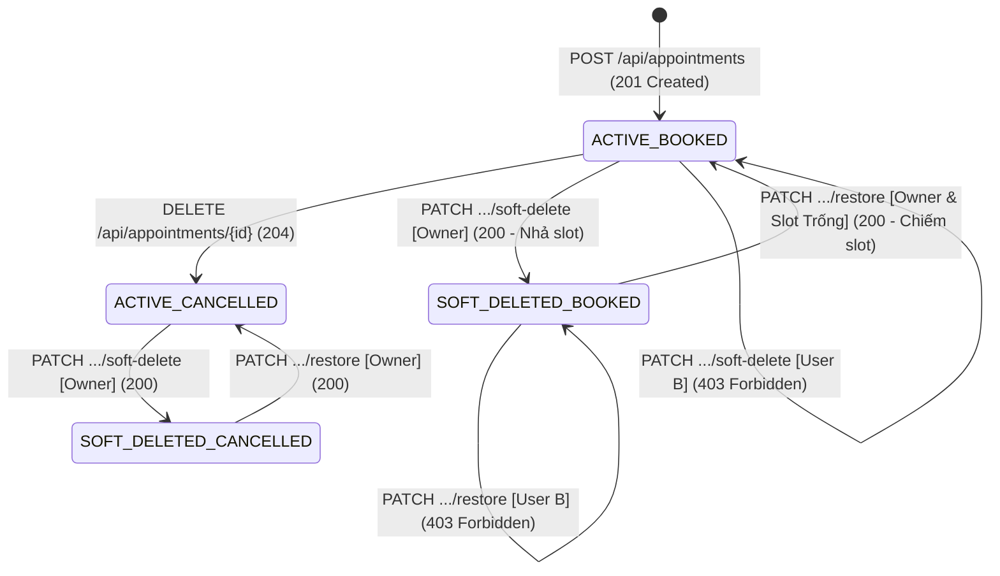

# CHIẾN LƯỢC KIỂM THỬ DỰA TRÊN RỦI RO & STATE TRANSITION TESTING (TEST STRATEGY)
**Bài tập cá nhân 3 — VT-116 | Production Readiness Lab (APP-03)**
- **Sinh viên thực hiện**: Nguyễn Việt Anh (MSSV: 23001827)
- **Nhóm**: SE2026-T29
- **Working Branch**: `bt3/23001827-vt116-soft-delete-restore`

---

## 1. PHÂN CẤP VÀ CHIẾN LƯỢC KIỂM THỬ (TEST LEVELS)

Để tối ưu hóa chi phí thực thi, tốc độ phản hồi và độ tin cậy phát hiện lỗi, chiến lược kiểm thử cho VT-116 áp dụng mô hình kim tự tháp (Testing Pyramid) với 2 cấp độ kiểm thử cốt lõi:

1. **Unit Tests (Cấp độ Service & Domain)**:
   - *Phạm vi*: Kiểm tra logic nghiệp vụ chuyển trạng thái (State transitions), kiểm tra điều kiện phân quyền (`owner_id == caller_id`), phát hiện lỗi vi phạm slot quá khứ hoặc slot trùng lặp thông qua repository mock/stub.
   - *Lợi ích*: Chạy cực nhanh (dưới 10ms), phản hồi tức thì về tính đúng đắn của thuật toán và các nhánh rẽ điều kiện (branch logic).
2. **Integration / API Tests (Cấp độ HTTP Boundary & PostgreSQL Database)**:
   - *Phạm vi*: Kiểm tra qua FastAPI TestClient (`httpx.AsyncClient`) tương tác trực tiếp với cơ sở dữ liệu PostgreSQL 18-alpine thật. Kiểm chứng transaction boundaries, rollback khi có lỗi, partial unique index `uq_appointments_active_starts_at`, và cách ly dữ liệu giữa nhiều người dùng thật.
   - *Lợi ích*: Chứng minh hệ thống hoạt động đúng trong môi trường thực tế, đảm bảo không có lỗi ẩn do ORM, driver `asyncpg` hay ràng buộc SQL.
3. **Các kiểm thử bị loại bỏ / Không cần thiết (Exclusions)**:
   - *E2E UI Tests (Playwright/Selenium)*: Không triển khai vì repo hiện chưa có giao diện React cho chức năng soft delete/restore. Việc giả lập browser chỉ làm tăng độ trễ và tính chập chờn (flakiness) mà không mang lại giá trị phát hiện lỗi cho tầng logic backend.
   - *Repeated Unit Tests cho Repository CRUD thuần túy*: Không viết test lặp lại cho các hàm SQLAlchemy session cơ bản đã được framework bảo đảm.

---

## 2. MA TRẬN TEST CASE (TEST CASE MATRIX)

Dưới đây là ma trận 12 test cases chuyên biệt, bao quát đầy đủ happy path, negative paths, failure paths, authorization isolation, và business invariant preservation:

| Test ID | Risk / Requirement | Test Level | Precondition / Input | Expected Result | Priority |
|---|---|---|---|---|---|
| **TC-01** | AC-01 / Happy-path Soft Delete | Integration | User A sở hữu Appointment 1 (`status='booked'`, `is_deleted=False`). User A gọi `PATCH /api/appointments/{id}/soft-delete` với header `X-User-Id: UserA`. | HTTP `200 OK`. DB: `is_deleted=True`, `deleted_at` có giá trị. Slot thời gian được giải phóng. | P0 |
| **TC-02** | AC-02 / Happy-path Restore | Integration | Appointment 1 đã bị soft delete bởi User A (`is_deleted=True`), slot vẫn còn trống. User A gọi `PATCH /api/appointments/{id}/restore` với header `X-User-Id: UserA`. | HTTP `200 OK`. DB: `is_deleted=False`, `deleted_at=None`. Appointment tái xuất hiện trong danh sách active. | P0 |
| **TC-03** | AC-01 / Anti-enumeration on Detail Read | Integration | Appointment 1 đã bị soft delete. Bất kỳ ai (User A hoặc User B) gọi `GET /api/appointments/{id}` thông thường. | HTTP `404 Not Found`. Bản ghi bị ẩn hoàn toàn khỏi API đọc thông thường, không rò rỉ dữ liệu. | P0 |
| **TC-04** | AC-06 / Idempotency Soft Delete | Unit / Integration | Appointment 1 đã ở trạng thái `is_deleted=True`. User A tiếp tục gọi `PATCH .../soft-delete` lần thứ 2. | HTTP `200 OK`. Idempotent: trạng thái giữ nguyên, không thay đổi mốc thời gian `deleted_at` ban đầu. | P1 |
| **TC-05** | AC-06 / Idempotency Restore | Unit / Integration | Appointment 1 đang ở trạng thái active (`is_deleted=False`). User A tiếp tục gọi `PATCH .../restore`. | HTTP `200 OK` (hoặc xử lý an toàn không đổi trạng thái), không gây lỗi hệ thống. | P1 |
| **TC-06** | RISK-01, AC-04 / Cross-User Soft Delete Attack | Integration | Appointment 1 thuộc sở hữu của User A. User B gửi request `PATCH /api/appointments/{id}/soft-delete` với header `X-User-Id: UserB`. | HTTP `403 Forbidden` (`AccessDeniedError`). Bản ghi của User A giữ nguyên, không bị xóa. | P0 |
| **TC-07** | RISK-01, AC-04 / Cross-User Restore Attack | Integration | Appointment 1 của User A đã bị soft delete. User B gửi request `PATCH /api/appointments/{id}/restore` với header `X-User-Id: UserB`. | HTTP `403 Forbidden` (`AccessDeniedError`). Quyền sở hữu được bảo vệ nghiêm ngặt. | P0 |
| **TC-08** | RISK-01, AC-04 / Cross-User Detail Read Attack | Integration | Appointment 1 của User A (chưa xóa). User B gửi `GET /api/appointments/{id}` với header `X-User-Id: UserB`. | HTTP `404 Not Found` (chống quét ID) hoặc `403 Forbidden`. User B không xem được thông tin của User A. | P0 |
| **TC-09** | AC-05 / Trash API Isolation | Integration | User A có 1 booking xóa mềm; User B có 1 booking xóa mềm. User A gọi `GET /api/appointments/trash` với `X-User-Id: UserA`. | HTTP `200 OK`. Danh sách chỉ trả về duy nhất booking của User A, tuyệt đối không có dữ liệu của User B. | P0 |
| **TC-10** | INV-01, AC-03 / Restore Slot Conflict | Integration | Appointment 1 của User A bị soft delete giải phóng slot 10:00. User C đặt mới một booking vào slot 10:00 (thành công 201). Sau đó User A yêu cầu restore Appointment 1. | HTTP `409 Conflict`. Hệ thống từ chối khôi phục do trùng slot, bảo vệ Partial Unique Index. | P0 |
| **TC-11** | Failure-Path / Restore Past Slot | Unit / Integration | Appointment 1 bị soft delete, nhưng mốc thời gian `starts_at` đã trôi vào quá khứ so với thời điểm hiện tại (`starts_at < now()`). User A yêu cầu restore. | HTTP `422 Unprocessable Entity` (hoặc `409 Conflict`). Từ chối khôi phục lịch hẹn quá khứ. | P1 |
| **TC-12** | Negative Path / Soft Delete Non-existent ID | Integration | User A gọi `PATCH /api/appointments/{random_uuid}/soft-delete`. | HTTP `404 Not Found` (`AppointmentNotFound`). | P1 |

---

## 3. THIẾT KẾ KIỂM THỬ CHUYỂN TRẠNG THÁI (STATE TRANSITION TESTING)

### 3.1. Phân tích Không gian Trạng thái (State Space)
Một bản ghi `Appointment` được định nghĩa bởi cặp trạng thái `(status, is_deleted)`:
1. **$S_1$: `ACTIVE_BOOKED`**: `status = 'booked'`, `is_deleted = False` (Lịch hẹn đang hoạt động, chiếm dụng slot).
2. **$S_2$: `ACTIVE_CANCELLED`**: `status = 'cancelled'`, `is_deleted = False` (Lịch hẹn đã hủy nghiệp vụ, slot đã giải phóng, vẫn thấy trong lịch sử).
3. **$S_3$: `SOFT_DELETED_BOOKED`**: `status = 'booked'`, `is_deleted = True` (Lịch hẹn bị đưa vào thùng rác, slot đã giải phóng theo chỉ đạo của sinh viên).
4. **$S_4$: `SOFT_DELETED_CANCELLED`**: `status = 'cancelled'`, `is_deleted = True` (Lịch hẹn đã hủy bị đưa vào thùng rác).

> **Làm rõ khái niệm RESTORED**: Trong kiến trúc hệ thống, `RESTORED` không phải là một trạng thái riêng biệt được lưu vào database mà là **hành vi chuyển trạng thái (transition)** đưa bản ghi từ $S_3$ quay trở lại $S_1$ (hoặc từ $S_4$ quay trở lại $S_2$).

### 3.2. Bảng Chuyển Trạng thái (State Transition Table)

| Mã | Trạng thái Hiện tại (Current State) | Sự kiện / Thao tác (Event / Action) | Điều kiện Tiên quyết (Guard Condition) | Trạng thái Đích (Next State) | Phản hồi API (API Response) | Phân loại Chuyển đổi |
|---|---|---|---|---|---|---|
| **T1** | $S_1$ (ACTIVE_BOOKED) | `soft_delete` | Caller là Owner | $S_3$ (SOFT_DELETED_BOOKED) | `200 OK` (Slot giải phóng) | Valid Transition |
| **T2** | $S_1$ (ACTIVE_BOOKED) | `cancel` | Caller là Owner | $S_2$ (ACTIVE_CANCELLED) | `204 No Content` | Valid Transition |
| **T3** | $S_3$ (SOFT_DELETED_BOOKED) | `restore` | Caller là Owner $\land$ Slot còn trống $\land$ $starts\_at > now()$ | $S_1$ (ACTIVE_BOOKED) | `200 OK` (Slot kích hoạt lại) | Valid Transition |
| **T4** | $S_3$ (SOFT_DELETED_BOOKED) | `restore` | Caller là Owner $\land$ **Slot ĐÃ CÓ người khác đặt** | $S_3$ (Không đổi) | `409 Conflict` | Conflict Path Transition |
| **T5** | $S_3$ (SOFT_DELETED_BOOKED) | `restore` | Caller là Owner $\land$ **Slot đã qua thời gian hiện tại** | $S_3$ (Không đổi) | `422 Unprocessable Entity` | Failure Path Transition |
| **T6** | $S_2$ (ACTIVE_CANCELLED) | `soft_delete` | Caller là Owner | $S_4$ (SOFT_DELETED_CANCELLED) | `200 OK` | Valid Transition |
| **T7** | $S_4$ (SOFT_DELETED_CANCELLED) | `restore` | Caller là Owner | $S_2$ (ACTIVE_CANCELLED) | `200 OK` | Valid Transition |
| **T8** | $S_3$ (SOFT_DELETED_BOOKED) | `soft_delete` | Caller là Owner | $S_3$ (Không đổi) | `200 OK` (Idempotent) | Repeated Operation |
| **T9** | $S_1$ (ACTIVE_BOOKED) | `restore` | Caller là Owner | $S_1$ (Không đổi) | `200 OK` (Idempotent) | Repeated Operation |
| **T10**| $S_1$ (ACTIVE_BOOKED) | `soft_delete` | **Caller KHÔNG PHẢI Owner** | $S_1$ (Không đổi) | `403 Forbidden` | Unauthorized Transition |
| **T11**| $S_3$ (SOFT_DELETED_BOOKED) | `restore` | **Caller KHÔNG PHẢI Owner** | $S_3$ (Không đổi) | `403 Forbidden` | Unauthorized Transition |
| **T12**| $S_3$ (SOFT_DELETED_BOOKED) | `cancel` | Bất kỳ | $S_3$ (Không đổi) | `404 Not Found` (Đã ẩn) | Invalid Transition |

### 3.3. Sơ đồ Chuyển Trạng thái (State Transition Diagram)

---
