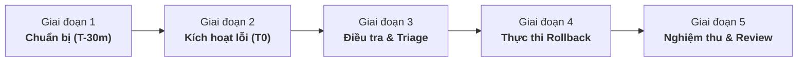

# Bảng phân vai và Danh mục kiểm tra diễn tập sự cố (Drill Roles & Checklist)

Tài liệu chuẩn bị cho đợt diễn tập sự cố chính thức (**Production Incident Drill**) của nhóm **SE2026-T29**, được đúc kết từ kết quả và bài học của đợt Diễn tập lần 1 (*Rehearsal 1* ngày 02/11/2026).

---

## 1. Phân vai và Trách nhiệm diễn tập (Drill Roles & Responsibilities)

Hệ thống diễn tập gồm 5 vai trò tương ứng với 5 thành viên trong nhóm theo phân công dự án:

| Vai trò diễn tập | Thành viên phụ trách | Phân công chính | Trách nhiệm chi tiết trong diễn tập |
| :--- | :--- | :--- | :--- |
| **Incident Commander (IC)**<br>*(Chỉ huy sự cố)* | **Nguyễn Việt Anh** | Release & Độ tin cậy (TASK-007) | • Điều phối tổng thể các giai đoạn diễn tập theo timeline.<br>• Kích hoạt bộ ghi timeline `drill_timeline.py` và snapshot toàn vẹn dữ liệu `booking_integrity.py`.<br>• Ra quyết định chính thức thực hiện Rollback khi lỗi được xác định.<br>• Kiểm tra và nghiệm thu thời gian khôi phục theo SLO (< 5 phút) bằng `verify_rollback_slo.py`. |
| **Observability Lead & Scribe**<br>*(Quan sát viên & Thư ký)* | **Vũ Thành Công** | Observability (TASK-006) | • Giám sát real-time trên Grafana Dashboards (HTTP Error Rate, Latency p95, Request volume).<br>• Theo dõi luồng cảnh báo trên Alertmanager và kênh thông báo Discord webhook (E11).<br>• Trích xuất Trace ID qua Grafana Tempo và đối soát log tương ứng trên Loki (E09).<br>• Ghi nhận chính xác mốc thời gian (timestamps) của Alert Pending, Firing và Resolved. |
| **Release & DevOps Operator**<br>*(Kỹ sư Vận hành & CI/CD)* | **Nguyễn Mai Hoàng Anh** | DevOps & Hạ tầng (TASK-004/005) | • Chuẩn bị môi trường Demo Host VM (Ubuntu 24.04 LTS, Docker Compose stack).<br>• Triển khai phiên bản gây lỗi `v0.2.0-drill` theo hiệu lệnh của IC.<br>• Theo dõi và kiểm soát quy trình GitHub Actions workflow `rollback.yml` hoặc chạy script rollback cục bộ trên host.<br>• Giám sát trạng thái container lifecycle và mạng nội bộ Docker. |
| **Backend & RCA Investigator**<br>*(Điều tra nguyên nhân gốc)* | **Phạm Minh Cương** | Backend & Kiến trúc (TASK-001/002) | • Phân tích mã nguồn và stacktrace của lỗi trả về (HTTP 500 / unhandled exception).<br>• Xác nhận nguyên nhân gốc rễ (Root Cause Analysis - RCA) do cờ `BOOKING_FAULT_MODE=error` hay do lỗi logic code.<br>• Đối chiếu tính tương thích của cơ sở dữ liệu PostgreSQL (schema migration Alembic, E14).<br>• Đưa ra đề xuất kỹ thuật cho IC về việc nên patch nóng hay rollback. |
| **Frontend & QA Verifier**<br>*(Kiểm chứng Giao diện & E2E)* | **Lê Văn Cường** | Frontend & E2E (TASK-003) | • Thực hiện các thao tác người dùng thực tế trên giao diện React Web UI trong suốt buổi diễn tập.<br>• Xác nhận hành vi của UI khi API lỗi (thông báo lỗi thân thiện, không hiển thị thành công ảo khi gặp 409/500, E06).<br>• Kiểm tra footer phiên bản (`/api/version`) trước, trong và sau khi rollback.<br>• Thực hiện smoke test luồng đặt lịch/hủy lịch trên UI sau khi hệ thống khôi phục. |

---

## 2. Quy trình diễn tập 5 giai đoạn (5-Phase Drill Workflow)



---

## 3. Danh mục kiểm tra chi tiết (Checklists)

### Phase 1: Chuẩn bị trước diễn tập (Pre-drill Checklist — T-30m đến T0)

- [ ] **Môi trường Demo Host:**
  - [ ] VM hoạt động bình thường, tài nguyên CPU < 30%, RAM trống > 2 GB, Disk trống > 10 GB.
  - [ ] Docker Compose production stack đang chạy ổn định ở phiên bản gốc `v0.2.0`.
  - [ ] Endpoint `/api/health/ready` trả về HTTP 200 `{"status": "ready"}`.
  - [ ] Endpoint `/api/version` hiển thị đúng version `v0.2.0` và commit SHA tương ứng.
- [ ] **Hạ tầng Giám sát & Báo động:**
  - [ ] Prometheus, Grafana, Alertmanager, Tempo, Loki và OpenTelemetry Collector đang `healthy`.
  - [ ] Kênh Discord diễn tập sẵn sàng nhận webhook từ Alertmanager (kiểm tra test notification).
  - [ ] Blackbox Exporter probe `/api/health/ready` trả về `probe_success == 1`.
- [ ] **Công cụ & Dữ liệu:**
  - [ ] Chạy lệnh dọn dẹp timeline cũ:
    ```bash
    python -m scripts.drill_timeline clear
    ```
  - [ ] Chụp snapshot dữ liệu đặt lịch ban đầu:
    ```bash
    python -m scripts.booking_integrity snapshot --output deploy/baseline-bookings.json --base-url http://localhost
    ```
  - [ ] Ghi mốc bắt đầu diễn tập:
    ```bash
    python -m scripts.drill_timeline record --event drill_start --description "Khoi dong buoi dien tap su co chinh thuc"
    ```

---

### Phase 2: Kích hoạt lỗi và Quan sát cảnh báo (Fault Injection & Alert Detection — T0 đến T+5m)

- [ ] **Kích hoạt sự cố:**
  - [ ] DevOps Operator triển khai bản dựng mang lỗi `v0.2.0-drill` hoặc kích hoạt cấu hình fault:
    ```bash
    BOOKING_FAULT_MODE=error BOOKING_FAULT_RATE=0.20
    ```
  - [ ] Ghi mốc thời gian kích hoạt lỗi vào timeline:
    ```bash
    python -m scripts.drill_timeline record --event fault_injected --description "Deploy v0.2.0-drill voi 20% 500 error"
    ```
- [ ] **Tạo tải người dùng (Synthetic Traffic):**
  - [ ] Chạy k6 hoặc script phát sinh tải (tối thiểu 5 - 10 req/s, đảm bảo > 100 req/phút):
    ```bash
    python -m scripts.observability_alert_traffic --rate 5 --duration 180
    ```
- [ ] **Quan sát phản ứng cảnh báo (Nghiệm thu E11):**
  - [ ] Quan sát Prometheus rule `BookingHighHttpErrorRate` chuyển từ `Inactive` sang `Pending` (sau 30s đánh giá).
  - [ ] Alert chuyển sang trạng thái `Firing` trong vòng **dưới 3 phút** kể từ khi điều kiện lỗi xuất hiện.
  - [ ] Nhận thông báo cảnh báo khẩn cấp từ Alertmanager gửi về kênh Discord kèm mô tả lỗi và URL biểu đồ.
  - [ ] Scribe ghi nhận chính xác UTC timestamp của alert firing vào nhật ký diễn tập.

---

### Phase 3: Điều tra và Ra quyết định (Incident Triage & Decision — T+5m đến T+8m)

- [ ] **Khảo sát Telemetry (Nghiệm thu E09):**
  - [ ] Mở Grafana Dashboard: Xác nhận tỷ lệ lỗi HTTP 5xx tăng vọt lên ~20%.
  - [ ] Vào Grafana Tempo: Tìm trace chứa span lỗi `http.response.status_code = 500`.
  - [ ] Lấy `trace_id` liên kết sang Loki: Đọc log lỗi chi tiết gắn với trace ID tương ứng.
- [ ] **Khảo sát Phía Người dùng (Nghiệm thu E06):**
  - [ ] Frontend Verifier thực hiện đặt lịch trên UI: Xác nhận UI hiển thị banner lỗi đỏ rõ ràng, không báo thành công ảo.
- [ ] **Kết luận nguyên nhân & Họp khẩn:**
  - [ ] Backend Investigator xác định release `v0.2.0-drill` có lỗi nghiêm trọng gây sụt giảm SLO.
  - [ ] IC ra quyết định chính thức: **ROLLBACK NGAY LẬP TỨC VỀ PHIÊN BẢN v0.2.0**.
  - [ ] Ghi nhận mốc thời gian quyết định:
    ```bash
    python -m scripts.drill_timeline record --event rollback_decision --description "Quyet dinh rollback ve v0.2.0"
    ```

---

### Phase 4: Thực thi Khôi phục (Rollback Execution — T+8m đến T+12m)

- [ ] **Kích hoạt quy trình Rollback tự động:**
  - [ ] Kích hoạt Rollback qua script hoặc GitHub Actions workflow dispatch:
    ```bash
    python -m scripts.rollback --verify-slo --slo-target 300
    ```
    *(Hoặc kích hoạt từ xa thông qua webhook trigger `trigger_rollback_dispatch.py`)*
  - [ ] Theo dõi log rollback: Quá trình recreate container, kiểm tra healthcheck và thực thi smoke tests.
- [ ] **Đánh giá thời gian Rollback (Nghiệm thu E12):**
  - [ ] Chạy công cụ thẩm định thời lượng rollback:
    ```bash
    python -m scripts.verify_rollback_slo --target-seconds 300 --fail-on-violation
    ```
  - [ ] Xác nhận thời gian hoàn tất rollback đo được đạt tiêu chuẩn SLO (**dưới 300 giây / 5 phút**).
  - [ ] Xác nhận endpoint `/api/version` đã trở về phiên bản lành `v0.2.0`.

---

### Phase 5: Nghiệm thu toàn vẹn và Kết thúc (Post-drill Verification — T+12m đến T+20m)

- [ ] **Kiểm tra Toàn vẹn Dữ liệu (Booking Data Integrity):**
  - [ ] Thực hiện đối soát toàn bộ bản ghi lịch hẹn so với snapshot ban đầu:
    ```bash
    python -m scripts.booking_integrity verify --baseline deploy/baseline-bookings.json --base-url http://localhost
    ```
  - [ ] Xác nhận 100% bản ghi đặt lịch được bảo toàn, không bị mất hoặc sai lệch trạng thái sau sự cố và rollback.
- [ ] **Kiểm tra Phục hồi Giám sát:**
  - [ ] Quan sát Prometheus rule `BookingHighHttpErrorRate` tự động chuyển về `Resolved` khi tỷ lệ lỗi giảm về 0%.
  - [ ] Alertmanager gửi thông báo `[RESOLVED]` vào kênh Discord.
- [ ] **Kiểm tra Dự phòng Probe Độc lập (Nghiệm thu E16):**
  - [ ] Tạm dừng container Backend API (`docker compose stop backend`).
  - [ ] Xác nhận Prometheus kích hoạt cảnh báo `ApiProbeDown` từ Blackbox probe trong vòng 1 phút dù không còn traffic HTTP.
  - [ ] Khởi động lại container Backend API (`docker compose start backend`).
- [ ] **Hoàn tất biên bản diễn tập:**
  - [ ] Đóng timeline diễn tập:
    ```bash
    python -m scripts.drill_timeline record --event drill_end --description "Ket thuc toan bo buoi dien tap"
    ```
  - [ ] Lập báo cáo sự cố chính thức theo mẫu [incident-report-template.md](incident-report-template.md).

---

## 4. Giao thức Truyền thông & Văn hóa Diễn tập (Communication Protocol)

1. **Kênh trao đổi tập trung:**
   - Kênh thoại (Voice meeting) để trao đổi khẩn cấp và ra quyết định trực tiếp.
   - Kênh văn bản Discord `#incident-drill` để ghi nhận các mốc thời gian, command output và hình ảnh bằng chứng.
2. **Cú pháp cập nhật trạng thái trong kênh chat:**
   - `[ALERT] <Tên alert> - <Trạng thái Firing/Resolved> - <Thời gian>`
   - `[ACTION] <Hành động thực hiện> - <Người thực hiện>`
   - `[DECISION] <Quyết định rollback/triage> - Phê duyệt bởi IC`
   - `[METRIC] <Chỉ số đo lường> (MTTR, SLO, Integrity ratio)`
3. **Nguyên tắc Văn hóa Không đổ lỗi (Blameless Culture):**
   - Diễn tập nhằm mục đích tìm kiếm điểm yếu của hệ thống, quy trình và công cụ tự động.
   - Mọi trục trặc, lỗi thao tác phát sinh đều là cơ hội cải tiến, tuyệt đối không quy trách nhiệm cá nhân.
