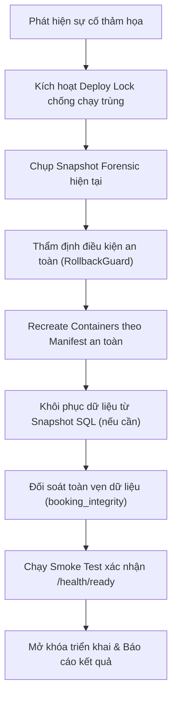

# Runbook — Quy trình Khôi phục Thảm họa (Disaster Recovery Procedures)

- **Người phụ trách:** **Nguyễn Việt Anh (23001827)** — Release & Độ tin cậy (TASK-005, TASK-007)
- **Mục tiêu:** Cung cấp quy trình từng bước ứng phó khi gặp sự cố nghiêm trọng vượt ngoài phạm vi rollback thông thường (hỏng volume dữ liệu, xung đột schema không tương thích hoặc lỗi host).
- **Mục tiêu RTO (Recovery Time Objective):** $\le 10\text{ phút}$.
- **Mục tiêu RPO (Recovery Point Objective):** $\le 0\text{ bản ghi}$ (Zero data loss đối với booking đã xác nhận).

---

## 1. Phân cấp mức độ thảm họa (Disaster Severity Levels)

| Cấp độ | Tình huống | Phương án khôi phục chính | Thời gian dự kiến |
| :---: | :--- | :--- | :---: |
| **L1** | Release code mang lỗi logic/5xx nhưng schema tương thích | Chạy Rollback tự động theo digest qua `scripts.rollback` | $< 60\text{ giây}$ |
| **L2** | Hỏng một phần dữ liệu hoặc trạng thái không nhất quán | Khôi phục từ snapshot gần nhất qua `scripts.db_snapshot` | $< 3\text{ phút}$ |
| **L3** | Mất volume PostgreSQL hoặc máy chủ demo sập nguồn | Khởi tạo lại stack từ base image và phục hồi bản dump đầy đủ | $< 10\text{ phút}$ |

---

## 2. Quy trình ứng cứu thảm họa từng bước (L2 & L3)



### Bước 1: Khóa triển khai khẩn cấp
Ngăn chặn mọi pipeline CI/CD hoặc người khác can thiệp đồng thời vào máy chủ:
```bash
python3 -m scripts.deploy_lock acquire --operation disaster_recovery --timeout 10
```

### Bước 2: Chụp snapshot dữ liệu phục vụ điều tra (Forensic Snapshot)
Trước khi thay đổi bất kỳ trạng thái nào, lưu giữ toàn bộ dữ liệu hiện tại:
```bash
python3 -m scripts.db_snapshot dump --prefix forensic_incident
python3 -m scripts.booking_integrity snapshot --output /tmp/forensic-bookings.json
```

### Bước 3: Thẩm định điều kiện an toàn với Rollback Guard
Kiểm tra dung lượng đĩa và tính tương thích của manifest mục tiêu:
```bash
python3 -m scripts.rollback --target-manifest docs/releases/v0.2.1.json --dry-run
```
Nếu Guard báo `[GUARD FAIL]`, xử lý giải phóng ổ đĩa hoặc chọn manifest tương thích tối thiểu trước khi tiếp tục.

### Bước 4: Khôi phục cấu hình và khởi động lại dịch vụ lành
```bash
python3 -m scripts.rollback \
  --target-manifest docs/releases/v0.2.1.json \
  --verify-slo \
  --slo-target 300
```

### Bước 5: Khôi phục cơ sở dữ liệu từ bản sao lưu (Nếu mất Volume)
Trong trường hợp volume PostgreSQL bị hỏng hoặc mất:
```bash
# 1. Liệt kê các bản dump có sẵn
python3 -m scripts.db_snapshot list

# 2. Kiểm tra tính toàn vẹn của tệp dump
python3 -m scripts.db_snapshot verify deploy/backups/pre-rollback_<timestamp>.sql

# 3. Phục hồi vào PostgreSQL
docker exec -i booking-postgres psql -U booking -d booking < deploy/backups/pre-rollback_<timestamp>.sql
```

### Bước 6: Đối soát tính toàn vẹn & Nghiệm thu
```bash
# 1. Xác nhận tính toàn vẹn 100% dữ liệu booking
python3 -m scripts.booking_integrity verify --baseline deploy/baseline-bookings.json

# 2. Chạy smoke test nghiệp vụ toàn diện
python3 -m scripts.smoke_test --base-url http://localhost:8000
```

---

## 3. Danh mục kiểm tra sau khôi phục (Post-Recovery Checklist)
- [ ] Endpoint `/api/health/ready` trả về HTTP 200.
- [ ] Endpoint `/api/version` trả về đúng release target (`v0.2.1` hoặc bản ổn định).
- [ ] Các slot thời gian hiển thị đúng múi giờ `Asia/Ho_Chi_Minh`.
- [ ] Cảnh báo trên Prometheus / Alertmanager tự động chuyển sang trạng thái `Resolved`.
- [ ] Báo cáo dòng thời gian sự cố được ghi lại bằng `scripts.drill_timeline`.
